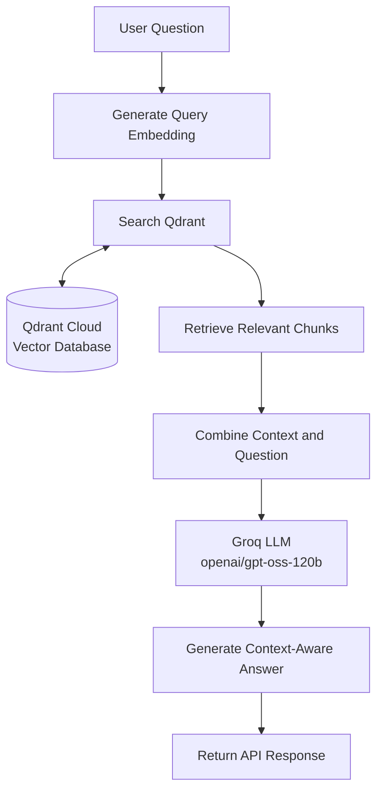

# 🚀 RAG Document Assistant

A Retrieval-Augmented Generation (RAG) application built with Node.js, Express, LangChain, Google Gemini embeddings, Qdrant Cloud, and Groq.

## 📌 Project Overview

This project implements a PDF-based document ingestion and question-answering pipeline.

It extracts text from PDF documents, divides the text into smaller chunks, converts the chunks into vector embeddings, and stores them in Qdrant for semantic retrieval.

The application uses retrieved document content to generate context-aware answers through a Groq-hosted language model.

## 🏗️ Phase 1 — Document Ingestion Architecture

```text
                 DOCUMENT INGESTION PIPELINE

                       ┌──────────────────┐
                       │   PDF Document   │
                       │  Knowledge.pdf   │
                       └────────┬─────────┘
                                │
                                ▼
                       ┌──────────────────┐
                       │   PDF Parsing    │
                       │    pdf-parse     │
                       └────────┬─────────┘
                                │
                                ▼
                       ┌──────────────────┐
                       │ Text Extraction  │
                       └────────┬─────────┘
                                │
                                ▼
                       ┌──────────────────┐
                       │  Text Chunking   │
                       │  LangChain       │
                       │                  │
                       │  Size: 1000      │
                       │  Overlap: 100    │
                       └────────┬─────────┘
                                │
                                ▼
                       ┌──────────────────┐
                       │   Embeddings     │
                       │ Google Gemini    │
                       │ gemini-embedding-001
                       └────────┬─────────┘
                                │
                                ▼
                       ┌──────────────────┐
                       │  Vector Storage  │
                       │  Qdrant Cloud    │
                       │  grocery-store   │
                       └──────────────────┘
```

## 🔄 How It Works

### 1. PDF Text Extraction

**Library:** `pdf-parse`

The application reads `Knowledge.pdf` and extracts its textual content.

```javascript
const buffer = fs.readFileSync("./Knowledge.pdf");

const pdfResult = new PDFParse({ data: buffer });
const result = await pdfResult.getText();

const text = result.text;
```

**Purpose:** Convert PDF content into text that can be processed by the application.

*Note: Scanned PDFs containing only images may require OCR.*

### 2. Text Chunking

**Library:** `@langchain/textsplitters`

The extracted text is divided into smaller, overlapping chunks.

```javascript
const splitter = new RecursiveCharacterTextSplitter({
  chunkSize: 1000,
  chunkOverlap: 100,
});

const docs = await splitter.createDocuments([text]);
```

| Parameter | Value | Purpose |
|---|---:|---|
| Chunk size | 1000 characters | Controls the approximate size of each chunk |
| Chunk overlap | 100 characters | Preserves context between adjacent chunks |

Chunking helps the retrieval system locate relevant sections instead of processing an entire document for every question.

### 3. Embedding Generation

**Provider:** Google Gemini  
**Model:** `gemini-embedding-001`  
**Library:** `@langchain/google-genai`

```javascript
const embeddings = new GoogleGenerativeAIEmbeddings({
  apiKey: process.env.GOOGLE_API_KEY,
  model: "gemini-embedding-001",
  taskType: TaskType.RETRIEVAL_DOCUMENT,
  title: "Document title",
});
```

Embeddings represent text as numerical vectors. These vectors allow the system to identify semantically related content.

For example, a question about rice prices can retrieve a chunk containing rice product information even if the question uses different wording.

The embedding model generates vectors; it does not generate the final answer.

### 4. Vector Database Storage

**Database:** Qdrant Cloud  
**Integration:** `@langchain/qdrant`  
**Collection:** `grocery-store`

```javascript
const vectorStore = await QdrantVectorStore.fromExistingCollection(
  embeddings,
  {
    url: process.env.QDRANT_URL,
    apiKey: process.env.QDRANT_API_KEY,
    collectionName: "grocery-store",
  }
);
```

The document chunks are added to the vector store:

```javascript
await vectorStore.addDocuments(docs);
```

Qdrant stores the vectors and associated document content for later semantic retrieval.

> The collection must exist and have a compatible vector configuration when using `fromExistingCollection()`.

## 🤖 Phase 2 — Retrieval and Generation

The question-answering workflow connects the stored document vectors to the language model.



### Retrieval workflow

1. Receive a question through the Express API.
2. Search Qdrant for semantically relevant document chunks.
3. Combine the retrieved content with the user's question.
4. Send the context and question to the Groq language model.
5. Return the generated answer as a JSON response.

The model is instructed to ground its answers in the retrieved document context.

## 📸 API Demo

The API accepts questions about information contained in the PDF.

**Endpoint:** `POST /ai`

**Example request:**

```json
{
  "input": "What is the price of potatoes?"
}
```

**Example response:**

```json
{
  "ai": "Potatoes (1 kg) - ₹35."
}
```


*Example of a successful API request and response.*

## 🧰 Technology Stack

| Technology | Role |
|---|---|
| Node.js | JavaScript runtime |
| Express.js | Backend framework and API |
| `pdf-parse` | PDF text extraction |
| Node.js `fs` | Reading PDF files |
| LangChain | Document processing and RAG integrations |
| `@langchain/textsplitters` | Text chunking |
| Google Gemini Embeddings | Embedding generation |
| Qdrant Cloud | Vector database |
| Groq | Language model inference |
| dotenv | Environment variable management |
| Nodemon | Development server restarts |

## 📂 Project Structure

```text
rag-document-assistant/
├── screenshots/
│   └── rag-potato-price.png
├── index.js
├── Knowledge.pdf
├── .env
├── .gitignore
├── package.json
├── package-lock.json
└── README.md
```

- `index.js` — Implements the ingestion pipeline and API routes.
- `Knowledge.pdf` — Source document used for retrieval.
- `screenshots/` — Contains API demo screenshots.
- `.env` — Stores credentials and environment configuration locally.
- `.gitignore` — Excludes secrets and generated files from Git.
- `package.json` — Defines project dependencies and scripts.

`node_modules/` is installed locally and should not be committed.

## ⚙️ Environment Configuration

Create a `.env` file in the project root:

```env
GOOGLE_API_KEY=your_google_api_key
GROQ_API_KEY=your_groq_api_key
QDRANT_URL=your_qdrant_cluster_url
QDRANT_API_KEY=your_qdrant_api_key
```

Load the variables using `dotenv`.

**Security:** Never commit `.env` or publish API keys. Use `.env.example` to document the required variable names without including real credentials.

## ✅ Project Status

### Completed

- PDF text extraction
- Document chunking
- Google Gemini embedding integration
- Qdrant vector storage
- Semantic document retrieval
- Groq-powered answer generation
- Express API endpoint
- Postman API testing

### Future Improvements

- Frontend chat interface
- Support for multiple documents
- Improved retrieval and ranking
- Source citations in answers
- Currency conversion through an external exchange-rate API
- Deployment of the backend API

## 🎯 Project Goal

Build a document-grounded AI assistant that retrieves relevant information from PDF files and generates useful answers using Retrieval-Augmented Generation.

**Core technologies:** Node.js · Express · LangChain · Gemini · Qdrant · Groq
